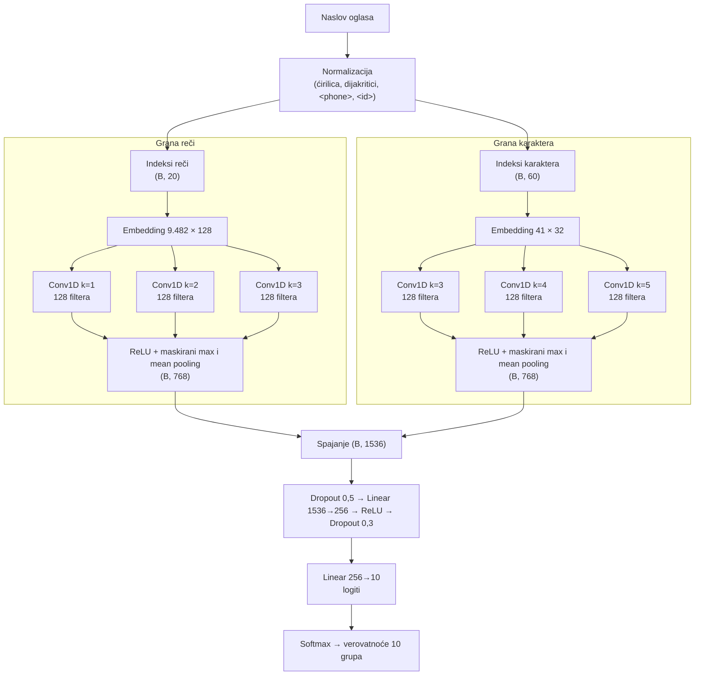
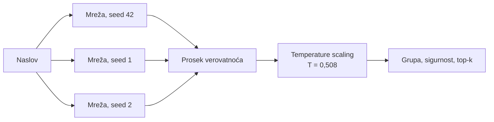

# Arhitektura modela

Konačni model (`models/ens_mm_ls_cal`) je **ansambl tri hibridne konvolucione mreže** iste arhitekture, obučene sa različitim seed-ovima, uz kalibraciju verovatnoća. Svaka mreža ima dve grane, jednu nad rečima i jednu nad karakterima naslova. Sve težine, uključujući embedding-e, uče se od nule na trening skupu. Pretrenirani modeli i vektori reči nisu korišćeni.

Implementacija: `src/kp_classifier/models/textcnn.py`, konfiguracija: `configs/hybrid_final.yaml`.

## 1. Pregled

Konačna predikcija:

## 2. Slojevi i dimenzije tenzora

`B` je veličina batch-a. Dimenzije su za jednu mrežu.

| sloj | izlaz | uloga |
|---|---|---|
| **ulaz reči** | (B, 20) | indeksi reči, dopunjeni sa `<pad>` do 20 |
| Embedding reči (9.482 × 128) | (B, 20, 128) | naučeni vektor za svaku reč vokabulara |
| Dropout 0,1 | (B, 20, 128) | regularizacija embedding-a |
| transpozicija | (B, 128, 20) | kanali × pozicije, oblik koji očekuje Conv1D |
| Conv1D k=1, 128 filtera + ReLU | (B, 128, 20) | detektori pojedinačnih ključnih reči (`brusilica`, `506`) |
| Conv1D k=2, 128 filtera + ReLU | (B, 128, 19) | detektori parova reči (`na sprat`, `imt 506`) |
| Conv1D k=3, 128 filtera + ReLU | (B, 128, 18) | detektori trojki reči |
| maskirani max pooling | 3 × (B, 128) | najjača aktivacija filtera bilo gde u naslovu |
| maskirani mean pooling | 3 × (B, 128) | prosečna aktivacija filtera po naslovu |
| **izlaz grane reči** | (B, 768) | |
| **ulaz karaktera** | (B, 60) | indeksi karaktera, dopunjeni do 60 |
| Embedding karaktera (41 × 32) | (B, 60, 32) | vektor za svako slovo, cifru i razmak |
| Conv1D k=3, 4, 5, po 128 filtera + ReLU | (B, 128, 58), (B, 128, 57), (B, 128, 56) | detektori nizova karaktera: koreni reči (`brus`), sufiksi, jedinice (`mm`, `m2`), delovi šifri |
| maskirani max i mean pooling | 6 × (B, 128) | |
| **izlaz grane karaktera** | (B, 768) | |
| spajanje grana | (B, 1536) | |
| Dropout 0,5 | (B, 1536) | |
| Linear 1536 → 256 + ReLU | (B, 256) | kombinovanje signala obe grane |
| Dropout 0,3 | (B, 256) | |
| Linear 256 → 10 | (B, 10) | logit za svaku grupu |
| softmax | (B, 10) | verovatnoće (samo pri predikciji) |

**Maskiranje:** pozicije sa `<pad>` se isključuju iz oba pooling-a, pa dopuna naslova ne utiče na rezultat. To je provereno testom (`tests/test_textcnn.py::test_padding_does_not_change_output`).

**Word dropout:** tokom treniranja se 10% reči u grani reči nasumično zamenjuje sa `<unk>`, pa mreža ne sme da se oslanja samo na jednu reč. Pri predikciji se ne primenjuje.

## 3. Broj parametara

| deo | parametara | udeo |
|---|---|---|
| embedding reči | 1.213.696 | 69,0% |
| konvolucije reči | 98.688 | 5,6% |
| embedding karaktera | 1.312 | 0,1% |
| konvolucije karaktera | 49.536 | 2,8% |
| Linear 1536 → 256 | 393.472 | 22,4% |
| Linear 256 → 10 | 2.570 | 0,1% |
| **ukupno, jedna mreža** | **1.759.274** | |
| **ansambl (3 mreže)** | **5.277.822** | |

Dve trećine parametara su u embedding-u reči. To je tipično za tekstualne modele: "pamćenje" vokabulara je skupo, a sama logika mreže je mala. Jedna mreža zauzima oko 7 MB na disku.

## 4. Obrazloženje odluka

Svaka odluka je ili izvedena iz analize podataka, ili proverena eksperimentom na validacionom skupu. Sve brojke grešaka u ovom odeljku su na validacionom skupu od 4.150 naslova, osim gde piše drugačije. Detalji eksperimenata su u [izveštaju sa treniranja](training_report.md).

### Zašto konvoluciona mreža

| svojstvo podataka | posledica |
|---|---|
| naslovi su kratki: prosečno 5,7 reči | sekvencijalni modeli (LSTM, Transformer) nemaju šta da modeluju |
| 76% čestih tokena gotovo jednoznačno određuje grupu | potreban je dobar **detektor ključnih reči i fraza**, a to je upravo konvolucija sa max pooling-om |
| redosled reči skoro ne utiče na grupu | ispremeštane reči menjaju tačnost svih modela za manje od 0,2 pp (test robusnosti) |
| ~33.000 trening primera | veliki modeli lako overfituju |

Razmotreni i odbačeni pristupi:
- **BiLSTM ili Transformer od nule:** sporiji i skloniji overfitovanju, a test sa ispremeštanim rečima pokazuje da redosled reči ne nosi korisnu informaciju,
- **pretrenirani embedding-i (fastText, word2vec) ili modeli (BERT):** nisu dozvoljeni zadatkom.

### Zašto dve grane

U validacionom skupu **35,7% naslova sadrži bar jednu reč koje nema u vokabularu** (retki brendovi, nazivi mesta, greške u kucanju, šifre). Grana reči za njih vidi samo `<unk>`, a grana karaktera vidi sva slova.

Kontrolisano poređenje, ista konfiguracija sa i bez grane karaktera:

| | samo reči | reči + karakteri |
|---|---|---|
| greške, validacioni skup | 51 | **39** |
| greške, test skup | 56 | **43** |
| greške, naslovi sa nepoznatom reči (test) | 48 | **33** |
| greške, jedna reč sa greškom u kucanju (test) | 187 | **105** |
| greške, dve reči sa greškom u kucanju (test) | 507 | **197** |

Grana karaktera smanjuje broj grešaka za oko četvrtinu na originalnim naslovima i za više od polovine kod grešaka u kucanju. Kada "brusilica" postane "brusilcia", grana reči vidi `<unk>`, a grana karaktera i dalje prepoznaje "brus" i "sil".

Sama grana karaktera nije dovoljna: mreža samo sa karakterima imala je 95 grešaka naspram 74 kod hibrida, u ranoj konfiguraciji bez label smoothing-a.

### Veličine kernela

- **reči, 1–3:** ključne fraze u naslovima su kratke (jedna do tri reči), a najduži naslov ima 19 reči,
- **karakteri, 3–5:** dužina tipičnih korena, sufiksa, jedinica i delova šifri.

### Maksimalne dužine ulaza

20 reči i 60 karaktera: baza odseca naslove na 60 karaktera, a najduži naslov ima 19 reči. Odseca se samo 0,05% naslova, zbog produžavanja teksta pri preslovljavanju.

### Max + mean pooling

Prva verzija koristila je samo max pooling. Analiza grešaka pokazala je da mreža greši **sa velikom sigurnošću kada jedna jaka fraza nadjača ostatak naslova**: "Silikonska futrola iqos 3 duo" je klasifikovana kao Samsung sa sigurnošću 1,000, jer je "silikonska futrola" jak signal za Samsung, a `iqos` (jak signal za upaljače) je ignorisan. Max pooling prenosi samo najjaču aktivaciju svakog filtera, dok logistička regresija sabira doprinose svih reči.

Mean pooling dodaje "ukupnu masu dokaza" po naslovu. Uz label smoothing, max + mean pooling je bio bolji na **sva tri seed-a** (prosečno 48,7 → 40,7 grešaka). Bez label smoothing-a nije doneo merljivu korist.

### Regularizacija

| tehnika | vrednost | razlog |
|---|---|---|
| dropout pre klasifikatora | 0,5 i 0,3 | standardna regularizacija guste glave |
| dropout embedding-a | 0,1 | |
| word dropout | 0,1 | mreža ne sme da zavisi od jedne reči; 76% čestih tokena sam određuje grupu |
| weight decay (AdamW) | 0,0001 | ekvivalent regularizacije `C` u baseline-u |
| **label smoothing** | **0,1** | ključna odluka, vidi ispod |
| gradient clipping | 1,0 | stabilnost na početku treniranja |

**Label smoothing** zamenjuje ciljnu raspodelu "1 za tačnu grupu, 0 za ostale" sa "0,91 za tačnu, 0,01 za svaku od ostalih". Bez njega je mreža postajala previše samouverena: val loss je počinjao da raste već oko 8–12. epohe dok je tačnost i dalje rasla, pa je rano zaustavljanje prekidalo treniranje prerano. Sa label smoothing-om prosečan broj grešaka na tri seed-a pao je sa 78 na 48,7, a rasipanje između seed-ova sa 16 na 6 grešaka.

### Ansambl

Tri mreže sa seed-ovima 42, 1 i 2 imaju 39, 45 i 38 grešaka, a ansambl 36. Važniji od samog dobitka je **stabilnost**: rezultat ne zavisi od izbora seed-a, koji je kod pojedinačnih mreža menjao broj grešaka i do 16.

Razmotren je i ansambl tri mreže i baseline-a (39 grešaka). Odbačen je, jer baseline daje znatno oštrije verovatnoće od mreža sa label smoothing-om, pa pri prostom proseku dominira upravo na primerima na kojima sam greši.

### Kalibracija (temperature scaling)

Zbog label smoothing-a mreže su **nedovoljno samouverene**: sigurnost je retko iznad 0,9, iako je tačnost iznad 99%. Kalibracijom se log-verovatnoće ansambla dele jednim brojem `T`, koji se bira tako da log loss na validacionom skupu bude minimalan. Dobijeno je `T = 0,508` (verovatnoće se izoštravaju).

| | bez kalibracije | sa kalibracijom |
|---|---|---|
| ECE, validacioni skup | 0,104 | 0,003 |
| ECE, test skup | – | **0,003** |
| log loss, test skup | – | 0,038 |

Kalibracija ne menja predikcije (najverovatnija grupa ostaje ista), već samo sigurnost. Pouzdana sigurnost je preduslov za pravilo tipa "automatski klasifikuj ako je sigurnost iznad praga, inače pošalji na proveru".

## 5. Obučavanje

| parametar | vrednost |
|---|---|
| funkcija gubitka | cross-entropy sa label smoothing-om 0,1 |
| optimizator | AdamW, learning rate 0,002, weight decay 0,0001 |
| batch | 128 |
| smanjenje learning rate-a | ×0,5 ako val loss ne opada 2 epohe |
| rano zaustavljanje | posle 5 epoha bez poboljšanja val loss-a, najviše 60 epoha |
| izbor epohe | najmanji val loss; vraćaju se težine te epohe |
| najbolje epohe tri mreže | 53, 44, 47 |
| uređaj i trajanje | Apple M1 (MPS), ~5 s po epohi, ~4–5 minuta po mreži |

## 6. Poznata ograničenja arhitekture

- **Zatvoren skup klasa:** model uvek bira jednu od 10 grupa. Za naslove koji ne pripadaju nijednoj, sigurnost ponekad ostaje visoka.
- **Grana karaktera vidi ceo tekst i kada word dropout sakrije reč**, pa je efekat word dropout-a u hibridu delimično poništen. Mreža samo sa rečima bolje se snalazi kada se ukloni ključna reč (326 naspram 380 grešaka na test skupu). Prirodno proširenje bilo bi da se ista reč tokom treniranja briše i iz niza karaktera.
- **Otpornost na greške u kucanju** je dobra zahvaljujući grani karaktera, ali je linearni model nad karakterskim n-gramima i dalje otporniji (139 naspram 170 grešaka kod dve reči sa greškom, test skup).
